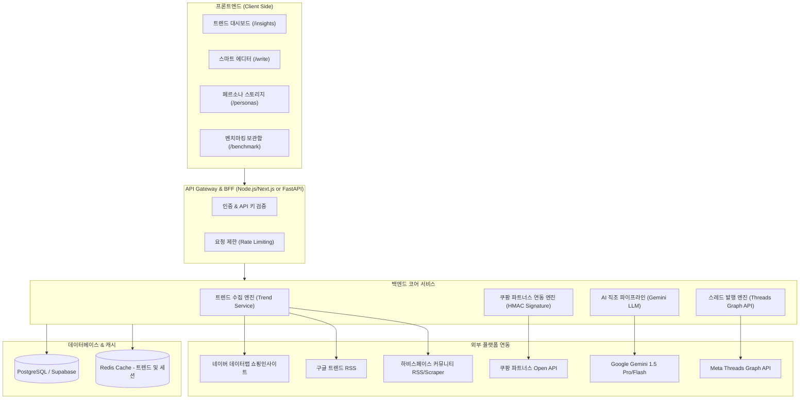
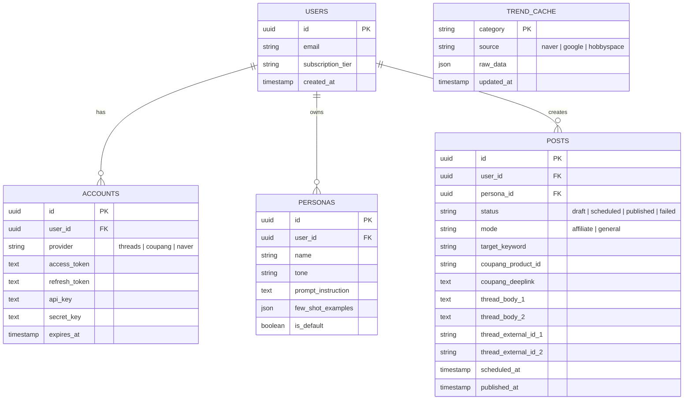

# DREATHS 클론 서비스 시스템 아키텍처 및 상세 기술 스펙 (PRD)

---

## 1. 프로젝트 개요 (Executive Summary)

### 1.1 배경 및 목적
본 프로젝트는 **DREATHS (`drt.agczero.com`)** 서비스의 UI/UX 및 비즈니스 로직을 리버스 엔지니어링하여, **소셜 미디어(Threads) 바이럴 콘텐츠 생성과 제휴마케팅(쿠팡 파트너스) 자동화**를 결합한 통합 마케팅 플랫폼을 구축하는 것을 목표로 합니다.

### 1.2 핵심 가치 제안 (Value Proposition)
1. **실시간 트렌드 포착**: 네이버 데이터랩, 구글 트렌드, 커뮤니티(하비스페이스 등) 인기 토픽을 한곳에 집계.
2. **원클릭 제휴 링크 매핑**: 발굴된 트렌드 키워드와 연관된 쿠팡 파트너스 상품을 즉시 검색하고 딥링크 발급.
3. **페르소나 기반 멀티 쓰레드 직조**: Gemini 모델을 활용해 본문 후킹 글 + 댓글 타래(쿠팡 링크 및 심의문구 포함) 구조로 분할 생성.
4. **Threads 직접 발행/예약**: Meta Threads Graph API 연동을 통해 원클릭 즉시 게시 및 타래 연쇄 발행.

---

## 2. 전체 시스템 아키텍처 (System Architecture)



---

## 3. 세부 기능 및 모듈별 상세 스펙

### 3.1 트렌드 & 인사이트 모듈 (`/dashboard/insights`)

#### (1) 네이버 데이터랩 쇼핑인사이트 연동
- **엔드포인트**: `POST https://openapi.naver.com/v1/datalab/shopping/categories`
- **카테고리 10종 지원**: 패션의류, 화장품/미용, 디지털/가전, 가구/인테리어, 출산/육아, 식품, 스포츠/레저, 생활/건강, 여가/생활편의, 도서.
- **수집 데이터**: 카테고리별 클릭 트렌드 상위 키워드 TOP 500 리스트.
- **캐싱 정책**: Redis TTL 1시간 (불필요한 API 할당량 소진 방지).

#### (2) 구글 트렌드 실시간 급상승 키워드
- **엔드포인트**: `GET https://trends.google.co.kr/trending/rss?geo=KR`
- **데이터 파싱**:
  - `title`: 급상승 검색어
  - `ht:approx_traffic`: 검색량 규모
  - `ht:news_item`: 연관 뉴스 제목 및 언론사 링크

#### (3) 최근 뜨는 커뮤니티 조사 (하비스페이스 연동)
- **대상 URL**: `https://bbs.hobbyspace.org`
- **데이터 취득 파이프라인**:
  - **1차 (RSS Feed)**: `GET https://bbs.hobbyspace.org/rss.xml`
    - `[AI 브리핑]`: 주요 이슈 키워드 20선, 경제, 토픽 브리핑
    - `[쇼핑/핫딜 추천]`: 실시간 쇼핑몰 핫딜 총정리
  - **2차 (웹 크롤러 / 헤드리스)**:
    - `/community/popular/post` 및 `/community/popular/ranking`
    - 게시글 제목, 작성 시간, 반응 점수 추출

---

### 3.2 쿠팡 파트너스 연동 엔진 (`CoupangAffiliateClient`)

쿠팡 파트너스 Open API는 엄격한 HMAC-SHA256 암호화 서명을 요구합니다.

#### (1) HMAC-SHA256 인증 헤더 생성 규격
```
Authorization: CEA algorithm=HmacSHA256, access-key={ACCESS_KEY}, signed-date={UTC_DATE_TIME}, signature={SIGNATURE}
```
- **날짜 포맷**: `yyMMdd'T'HHmmss'Z'` (UTC 기준, 예: `261020T081500Z`)
- **서명 원문 (Message)**: `{DATE}{METHOD}{URL_PATH}{QUERY_STRING}`
- **서명 생성**: `HMAC-SHA256(Message, SECRET_KEY)` 후 Hex 인코딩.

#### (2) 핵심 연동 엔드포인트
1. **상품 검색**:
   - `POST https://api-gateway.coupang.com/v2/providers/affiliate_open_api/apis/openapi/products/search`
   - Request Body: `{"keyword": "닭가슴살", "limit": 10}`
   - 반환 데이터: `productId`, `productName`, `productPrice`, `productImage`, `productUrl`
2. **트래킹 딥링크 발급**:
   - `POST https://api-gateway.coupang.com/v2/providers/affiliate_open_api/apis/openapi/deeplink`
   - Request Body: `{"coupangUrls": [productUrl]}`
   - 반환 데이터: `shortenUrl` (예: `https://link.coupang.com/a/...`)

---

### 3.3 스마트 에디터 및 AI 직조 엔진 (`/write`)

#### (1) 작성 모드 (Writing Modes)
1. **간편/전문성 글작성**: 제휴 링크 없이 인사이트/정보 전달 중심.
2. **쿠팡파트너스 제휴마케팅**: 상품 정보와 딥링크를 본문 또는 1번 댓글에 전략적 배치.
3. **심의 필터링**: 공정거래위원회 추천보증심사 지침 준수 문구 강제 포함.
   - 표준 고지 문구: *"이 포스팅은 쿠팡 파트너스 활동의 일환으로, 이에 따른 일정액의 수수료를 제공받습니다."*

#### (2) 타래(Thread) 분할 생성 아키텍처
스레드(Threads) 알고리즘은 1번 글(본문)에 외부 링크가 들어갈 경우 도달률(Reach)에 페널티를 부여하는 경향이 있습니다. 따라서 엔진은 반드시 **2-Stage 타래 구조**로 생성합니다:

```
[Thread 1 - 본문 후킹 및 경험담]
- 500자 이내
- 독자의 공감대 및 문제의식 자극
- 제품의 특장점 자연스럽게 언급 (가격, 용량 등)
- CTA: "자세한 링크는 첫 댓글에 남겨둘게!"

[Thread 2 - 댓글 타래 (구매 링크 & 법적 고지)]
- 쿠팡 파트너스 숏링크 포함
- 공정위 심의 고지 문구 필수 포함
```

#### (3) Gemini 프롬프트 직조 템플릿 구조
- **System Prompt**: 페르소나 스타일(어조, 말투, 문장 길이, 이모지 빈도) 주입.
- **Context Injection**:
  - 선택된 상품 정보: `{productName}`, `{price}`, `{features}`
  - 타겟 키워드: `{keyword}`
  - 사용자 맞춤 지침 (예: "성시경 레시피 스타일", "친근한 반말")

---

### 3.4 페르소나 관리 스토리지 (`/dashboard/personas`)

사용자가 작성 스타일을 사전 프리셋으로 등록하고 선택할 수 있도록 설계합니다.

- **기본 프리셋 (DREATHS 기본 내장 복제)**:
  1. `현실 부부 일상/유머 (Hey Mongle 스타일)`: 친근하고 위트 있는 대화체 반말.
  2. `치트키 팩폭 코치 (팔뚝살/스트레칭 스타일)`: 단호하고 전문적인 큐레이션.
  3. `초간단 맛도리 다이어터 (성시경/홍진경 레시피 스타일)`: 진정성 있는 내돈내산 톤.
  4. `정보 큐레이터/뉴스 배달부`: 객관적이고 깔끔한 요약체.
- **사용자 정의 페르소나 (Custom CRUD)**:
  - 페르소나 명칭, 말투 설명, 예시 문장(Few-shot examples), 금지 단어 목록.

---

### 3.5 Threads 공식 API 연동 규격

Meta Graph API (`v1.0`)는 비동기 Container 생성을 거칩니다.

#### (1) 포스팅 2단계 워크플로우
1. **Container 생성**:
   - `POST https://graph.threads.net/v1.0/{threads-user-id}/threads`
   - Params:
     - `media_type=TEXT`
     - `text={thread_1_content}`
   - Response: `{"id": "container_id_1"}`
2. **Container 발행 (Publish)**:
   - `POST https://graph.threads.net/v1.0/{threads-user-id}/threads_publish`
   - Params: `creation_id={container_id_1}`
   - Response: `{"id": "published_thread_id_1"}`
3. **타래(Reply) 발행**:
   - `POST https://graph.threads.net/v1.0/{threads-user-id}/threads`
   - Params:
     - `media_type=TEXT`
     - `text={thread_2_link_and_disclaimer}`
     - `reply_to_id={published_thread_id_1}`
   - 이어서 `threads_publish` 호출하여 타래 완성.

---

## 4. 데이터베이스 ERD 설계



---

## 5. 백엔드 REST API 인터페이스 명세

| Method | Endpoint | 설명 |
| :--- | :--- | :--- |
| `GET` | `/api/v1/trends/insights` | 카테고리별 네이버/구글/커뮤니티 트렌드 통합 조회 |
| `GET` | `/api/v1/trends/hobbyspace` | 하비스페이스 실시간 이슈/핫딜 및 인기글 조회 |
| `POST` | `/api/v1/coupang/search` | 쿠팡 상품 검색 (키워드 입력) |
| `POST` | `/api/v1/coupang/deeplink` | 원본 쿠팡 URL을 트래킹 숏링크로 변환 |
| `POST` | `/api/v1/editor/weave` | 페르소나 및 상품 기반 멀티 스레드 원고 직조 (Gemini) |
| `GET` | `/api/v1/personas` | 등록된 페르소나 목록 조회 |
| `POST` | `/api/v1/personas` | 신규 페르소나 생성 |
| `POST` | `/api/v1/threads/publish` | 스레드 즉시 발행 (본문 + 타래 연쇄 발행) |
| `POST` | `/api/v1/threads/schedule` | 예약 발행 등록 |

---

## 6. 개발 로드맵 및 구현 가이드

- **Phase 1: 데이터 수집 & 유틸리티 구축**
  - 쿠팡 파트너스 HMAC-SHA256 모듈 작성 및 검증.
  - 네이버 데이터랩, 구글 트렌드 RSS, 하비스페이스 RSS 파서 모듈화.
- **Phase 2: LLM 직조 엔진 & 프롬프트 최적화**
  - Gemini SDK 연동 및 Threads 알고리즘에 맞춘 2단 타래 구조 프롬프트 템플릿 완성.
  - 법적 필수 심의 문구 자동 삽입 가드레일 적용.
- **Phase 3: Threads Graph API 통합**
  - OAuth 토큰 갱신 및 컨테이너 생성/발행/타래 체이닝 파이프라인.
- **Phase 4: 프론트엔드 대시보드 및 에디터 구현**
  - 영상 속 다크/라이트 모드 레이아웃, 키워드 원클릭 에디터 연계 UI 개발.
